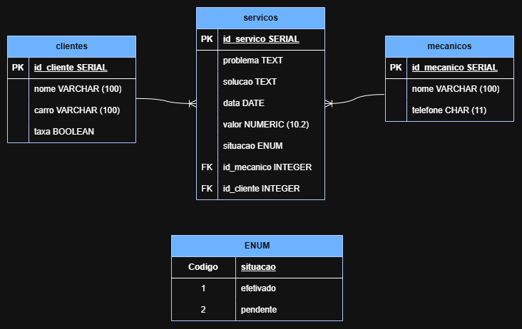

# Osvaldo Motors
Esse site foi solicitado por Osvaldo Pereira da Silva. Destinado para uma mecânica de carros em que o objetivo do dono é organizar seu negócio como, login, cadastro dos carros e facilidade no seu dia a dia.

## Mer
### clientes
- id_cliente PK
- nome VARCHAR(100)
- carro VARCHAR (100)
- taxa BOOLEAN

### mecanicos
- id_mecanico SERIAL PK
- nome VARCHAR (100)
- telefone CHAR (11)

### servicos
- id_servico SERIAL PK
- problema TEXT
- solucao TEXT
- data DATE
- valor NUMERIC (10.2)
- situacao ENUM(situacao_pagamento)
- id_mecanico INTEGER FK
- id_cliente  INTEGER FK

### relacionamento
- 1 cliente para N serviços
- 1 mecanico para N serviços
## Der

